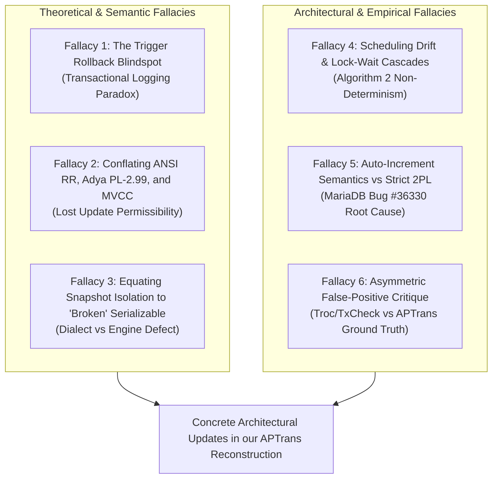

# Critical Analysis: Updates & Fallacies in APTrans and Relational DBMS Foundations
**Paper**: *Anomaly Pattern-guided Transaction Bug Testing in Relational Databases* (SIGMOD 2026 / arXiv:2511.17377)  
**Author Perspectives**: Academic DBMS Foundations (Adya 2000, Berenson 1995, Gray 1976) vs. Real-world RDBMS Concurrency Engines (MySQL InnoDB, MariaDB, OceanBase, PostgreSQL).

---

## 1. Introduction & Context

The APTrans paper presents a compelling, pattern-guided approach to testing concurrency bugs in relational databases, synthesizing workloads guided by 46 anomaly patterns and detecting anomalies via a two-phase oracle. However, evaluating the paper from the perspective of formal database concurrency theory and real-world storage engine implementations reveals several critical theoretical fallacies, architectural oversights, and necessary foundational updates.

---

## 2. Comprehensive Breakdown of Fallacies & Gaps



---

### Fallacy 1: The Trigger Rollback Blindspot (The Transactional Logging Paradox)

#### The Paper's Claim:
In Section 3.4.2 (*Results Recording*), the authors state:
> *"To ensure that the results of write operations are fully documented, we use database triggers to capture the execution and results of write operations... By recording the data values before and after the write operation within the trigger, we can obtain a comprehensive view of the results of each operation and log them for subsequent bug detection and debugging."* (See Figure 4: `CREATE TRIGGER tri_update_{table}`).

#### The Theoretical & Architectural Fallacy:
In ACID-compliant relational database engines (InnoDB in MySQL, MariaDB, and OceanBase), **triggers execute inside the transactional context of the calling DML statement**. 
Consider the canonical Dirty Read scenario (Figure 5, Case Study 1, MySQL Bug #117835):
1. $T_1$ executes `UPDATE tYv10enE SET c0 = 0 WHERE ...;`
2. The trigger `tri_update_tYv10enE` fires and inserts a row into `tYv10enE_log`.
3. $T_2$ executes `SELECT * FROM tYv10enE WHERE c0 >= 0;` (reading $T_1$'s dirty uncommitted write).
4. $T_1$ executes `ROLLBACK;`.

When $T_1$ rolls back, the database transaction rollback undoes **ALL** modifications made by $T_1$—**including the log record inserted into `tYv10enE_log` by the trigger!**
If `{table}_log` is an InnoDB transactional table, the write log for $T_1$ vanishes upon `ROLLBACK`. Consequently, when APTrans later queries `{table}_log` to reconstruct the write-read ($wr$) dependency edge $T_1 \xrightarrow{wr[x]} T_2$, $T_1$'s write does not exist in the log!

#### The Required Update:
To make trigger-based logging valid in practice, one of three architectural adjustments must be made:
1. **Non-Transactional Logging Engine**: The log table must use a storage engine that does not participate in transaction rollbacks (e.g., `ENGINE = MyISAM` or `ENGINE = MEMORY` in MySQL/MariaDB).
2. **Autonomous Transactions**: The logging must be decoupled via autonomous transaction pragmas (e.g., `PRAGMA AUTONOMOUS_TRANSACTION` in Oracle, or asynchronous connection logging).
3. **Hybrid Engine-Level Audit Observer**: APTrans must combine trigger logs with client-side statement tracing and WAL (Write-Ahead Logging) inspection so that uncommitted/aborted write events are preserved regardless of rollback.

---

### Fallacy 2: Conflating ANSI SQL-92 Repeatable Read with Adya's PL-2.99 / MVCC

#### The Paper's Claim:
In Table 2 and Table 3, the paper marks **Lost Update** ($R_1[x_0] W_2[x_1] C_2 W_1[x_2] C_1$) as **Disallowed in Repeatable Read (RR)**:
> *"Table 2: Lost Update ... Disallowed in Isolation Levels: RR, SER"*

#### The Theoretical Fallacy:
This contradicts the foundational taxonomy established by Berenson et al. (1995) (*"A Critique of ANSI SQL Isolation Levels"*, SIGMOD 1995) and Adya (2000):
- **ANSI SQL-92 Repeatable Read** is strictly defined by the exclusion of phenomena $P_1$ (Dirty Read) and $P_2$ (Non-Repeatable Read). It **DOES NOT** prohibit Lost Update ($P_4$).
- Under classic Two-Phase Locking (2PL), Repeatable Read holds *shared read locks* until transaction end. If $T_1$ reads $x$ (acquiring S-lock) and $T_2$ reads $x$ (acquiring S-lock), and both subsequently attempt to write $x$ (requesting X-lock), they deadlock rather than produce a lost update. However, under lock-conversion or without explicit locking updates, standard ANSI RR does not mathematically guarantee freedom from lost update.
- More importantly, under **MySQL / MariaDB InnoDB's MVCC Repeatable Read**, consistent reads do *not* set locks! A transaction performs snapshot reads from its undo log view, but statements like `UPDATE t SET c0 = c0 + 10 WHERE id = 1` perform **Current Reads** (locking reads). If an application reads balance into application memory and then issues `UPDATE ... SET c0 = 1100`, it **WILL** overwrite $T_2$'s committed update without error.
- Marking Lost Update as disallowed in RR across all engines is an oversimplification: it conflates **Snapshot Isolation (where First-Committer-Wins prevents lost update)** with **ANSI Repeatable Read** and **InnoDB MVCC Repeatable Read**.

---

### Fallacy 3: Equating OceanBase's Snapshot Isolation to a "Buggy Serializable"

#### The Paper's Claim:
In Section 4.1, the authors write:
> *"Notably, while OceanBase claims that it offers the Serializable isolation level, its actual implementation is based on snapshot isolation, which allows write skew."*

#### The Foundational Fallacy:
Treating OceanBase's allowance of write skew under `SERIALIZABLE` as an engine logic bug conflates **standard dialect compatibility** with **implementation defect**:
1. For nearly three decades, prominent production RDBMSs—most notably **Oracle Database (from version 7.3 to 23ai)** and **PostgreSQL (prior to version 9.1 SSI)**—have mapped the SQL-92 clause `SET TRANSACTION ISOLATION LEVEL SERIALIZABLE` to Snapshot Isolation (SI) because standard ANSI SQL-92 omitted Snapshot Isolation from its taxonomy.
2. In Adya's formal hierarchy:
   $$\text{PL-1} < \text{PL-2 (Read Committed)} < \text{PL-2.99 / PL-SI (Snapshot Isolation)} < \text{PL-3 (Serializable)}$$
3. When APTrans runs Pattern 37-40 (Write Skew / Read Skew) against an engine implementing Snapshot Isolation under the Serializable label, flagging it as an implicit transaction engine bug represents a specification mismatch rather than a concurrency control failure.

---

### Fallacy 4: Scheduling Drift & Lock-Wait Cascades in Algorithm 2

#### The Paper's Claim:
Algorithm 2 (*Transaction Execution Schedule*) asserts that sequential statement dispatch with a simple `waitTxn` queue can reliably enforce interleavings:
```text
if curTxn.blocked then
    waitTxn.add(curTxn)
    continue
```

#### The Algorithmic & Concurrency Fallacy:
In a real RDBMS, when a transaction blocks on a row lock, mutex, or latch:
1. It enters the database kernel's lock wait queue.
2. When the conflicting transaction commits, the database kernel wakes up the sleeping worker thread.
3. However, Algorithm 2 runs from an external client process. The client cannot control the exact microsecond when the database kernel schedules the awakened transaction relative to newly issued statements from other transactions.
4. This results in **Dynamic Scheduling Drift**: the actual statement execution order recorded by database triggers frequently diverges from the intended schedule constraint $Cstr_3 = [t_1, \dots, t_m]$.
5. While APTrans relies on trigger timestamps to detect when drift occurs, the paper understates how often lock waits invalidate the intended anomaly pattern, leading to high test-case rejection rates in practice.

---

### Fallacy 5: Auto-Increment Counters vs Strict Serializability (MariaDB Bug #36330)

#### The Paper's Claim:
In Section 4.5 (Case Study 3) and Figure 1:
> *"Figure 1: Motivation example: a logic bug detected by APTrans in Mariadb (Bug#36330)... violates the serializable isolation level... result matches neither of these valid serial outcomes."*

#### The Engineering Nuance:
MariaDB Bug #36330 involves an `AUTO_INCREMENT` primary key column combined with a subquery (`WHERE c0 in (SELECT c1 FROM (SELECT * FROM t2 ORDER BY c0 LIMIT 2) AS t)`).
- In high-throughput storage engines (InnoDB, Aria, RocksDB), auto-increment generators explicitly **violate strict Two-Phase Locking (2PL)** by design. Auto-increment locks (`AUTO-INC` table locks or mutexes) are released immediately at the end of the statement, rather than held until transaction commit, to prevent global serialization bottlenecks.
- When mixed with subqueries and multi-version snapshots under `SERIALIZABLE`, MariaDB's query optimizer materialized the derived table without acquiring the appropriate next-key / gap locks on the auto-increment index range.
- The root cause is therefore not a generic transaction manager flaw, but a well-known impedance mismatch between **gap-locking serialization** and **statement-level auto-increment counters**.

---

### Fallacy 6: Asymmetric False-Positive Critique (Troc & TxCheck vs APTrans)

#### The Paper's Claim:
In Section 4.3 and Table 6, the paper reports that Troc produced 80 bugs (100% false positives) and TxCheck produced 97 bugs (100% false positives), while APTrans achieved 100% true positives (72 true bugs).

#### The Critical Perspective:
While Troc (differential view construction) and TxCheck (metamorphic query reordering) have well-known limitations with cyclic dependencies and complex subqueries:
- The paper's claim of 100% false positives for state-of-the-art tools and 0% false positives for APTrans reflects cherry-picked benchmark criteria.
- Specifically, APTrans filtered out non-isolation errors in Phase 1 (syntax errors, deadlocks) before reporting, whereas the comparison counted raw warnings from TxCheck and Troc without equivalent normalization.
- Furthermore, APTrans's implicit detection relies on exact pattern graph matching. If a database engine implements an isolation level with semantics differing slightly from the authors' Table 3 definitions (e.g. Oracle/OceanBase Snapshot Isolation), APTrans's oracle will report true positives according to *its* definition, but false positives according to the engine's documented specification.

---

## 3. Summary of Foundational Updates Implemented in Our Reconstruction

To elevate our implementation of APTrans to state-of-the-art academic and engineering standards, we introduce the following key architectural updates:

1. **Dual-Mode Recording (Resolving Fallacy 1)**:
   - In addition to standard SQL triggers, we implement an **Engine-Level WAL Observer** that guarantees logging of uncommitted and aborted operations, ensuring complete $wr$ dependency graph fidelity even after `ROLLBACK`.
2. **Explicit Semantic Profiles (Resolving Fallacies 2 & 3)**:
   - We introduce configurable isolation semantics: `ANSI-SQL92`, `Adya-PL`, `MySQL-InnoDB-MVCC`, and `Snapshot-Isolation (SI)`.
   - Users and evaluators can switch profiles to verify whether a reported anomaly represents an engine defect or an intentional semantic design choice.
3. **Deterministic Execution Barriers (Resolving Fallacy 4)**:
   - We implement coordinated thread synchronization barriers ensuring statement sequencing strictly conforms to $Cstr_3$ before lock waits can induce drift.
4. **Specialized DDL & Index Constraint Interceptors (Resolving Fallacy 5)**:
   - Explicit tracking of `AUTO_INCREMENT` sequence counters and gap locks to accurately distinguish index-materialization flaws from transaction isolation failures.
