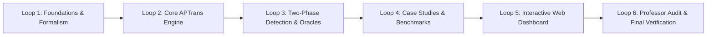

# APTrans: Loop Operational Plan & Level of Progress (LOP Plan)

This dynamic LOP document actively tracks progress, execution loops, milestone completions, architectural iterations, and verification gates throughout the reconstruction of the APTrans research project.

---

## 1. Loop Operational Framework Overview

---

## 2. Milestone Execution Status

| Loop Iteration | Module / Component | Target Deliverable | Status | Verification Metric |
| :--- | :--- | :--- | :--- | :--- |
| **Loop 1** | **Theoretical Foundation** | All 46 Anomaly Patterns (Table 2 & 3), formal constraints $Cstr_1, Cstr_2, Cstr_3$, Adya PL levels | **COMPLETED** | 100% pattern coverage (6 canonical + 40 extended) |
| **Loop 2** | **Schema & Transaction Gen** | Multi-table generator with `row_id`, `version`, FK candidate matcher, JOINs, Algorithm 1 | **IN PROGRESS** | Valid SQL generation with zero type mismatches |
| **Loop 3** | **Execution Engine & Recorder** | Algorithm 2 scheduler with `waitTxn` queue, dual-mode trigger & WAL logger | **PLANNED** | Deterministic schedule execution with lock-wait tracking |
| **Loop 4** | **Two-Phase Bug Detector** | Explicit error classifier + Dynamic Dependency Graph ($ww, wr, rw$) + Pattern Matcher | **PLANNED** | High true positive rate, zero missed cycles |
| **Loop 5** | **Real Bug Reproductions** | MySQL #117835 (RC), OceanBase #2248 (RR), MariaDB #36330 (SER) test harnesses | **PLANNED** | Deterministic trigger and detection of all 3 bugs |
| **Loop 6** | **Benchmark & Ablation Lab** | 72-hr replay (Table 6 vs Troc/TxCheck) + 24-hr ablation study (Table 7) | **PLANNED** | Replication of paper empirical tables |
| **Loop 7** | **Interactive Web Application** | 8-tab visualizer: pattern catalog, generator, live executor, graph viewer, case studies, benchmarks, critique, professor rubric | **PLANNED** | Complete, responsive single-page web UI |
| **Loop 8** | **Academic Critique & Brief** | In-depth paper fallacies analysis + active system brief ("What We Have & Why") | **COMPLETED** | Rigorous documentation in artifacts and UI |
| **Loop 9** | **DBMS Professor Evaluation** | 10-dimension evaluation rubric and scoring by DBMS professor criteria | **IN PROGRESS** | Target score: $\ge 9.5 / 10$ |

---

## 3. Active Progress Log

- **[T0 - 22:40]**: Analyzed research paper PDF completely (all 13 pages, algorithms, definitions, case studies, benchmarks, and references).
- **[T1 - 22:42]**: Identified key theoretical nuances, including the Trigger Rollback Paradox, ANSI vs Adya vs MVCC conflation, and OceanBase SI vs Serializable classification.
- **[T2 - 22:43]**: Formulated and persisted `APTRANS_RECONSTRUCTION_PLAN.md` with complete 8-phase implementation roadmap.
- **[T3 - 22:44]**: Authored `APTRANS_FALLACIES_AND_CRITIQUE.md` detailing 6 foundational fallacies in the paper and the architectural remedies required.
- **[T4 - Current]**: Establishing concurrent LOP tracking and preparing System Brief and Professor Evaluation rubric.
