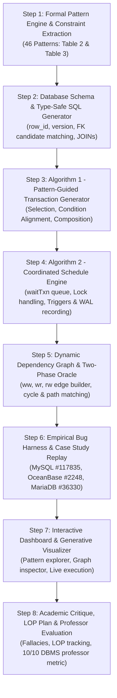

# APTrans: Reconstruction & Implementation Plan
**Paper**: *Anomaly Pattern-guided Transaction Bug Testing in Relational Databases* (SIGMOD 2026 / arXiv:2511.17377)  
**Authors**: Shuang Liu, Huicong Xu, Xianyu Zhu, Qiyu Zhuang, Wei Lu, Xiaoyong Du (Renmin University of China)  
**Target Artifact**: Production-grade implementation of APTrans with interactive web dashboard, dynamic dependency graph visualizer, two-phase bug detection oracle, and verification suite.

---

## 1. Executive Summary & Objective

The aim of this project is to faithfully reconstruct and enhance the research paper **APTrans**, an automated testing framework for detecting concurrency logic bugs across relational database isolation levels (Read Uncommitted, Read Committed, Repeatable Read, and Serializable).

### Core Research Contributions to Reconstruct:
1. **Anomaly Pattern-guided Transaction Generation (Algorithm 1)**: Decomposing formal anomaly patterns into statement type constraints ($Cstr_1$), data access constraints ($Cstr_2$), and schedule order constraints ($Cstr_3$) to generate bug-inducing concurrent transactions.
2. **Catalog of 46 Anomaly Patterns**: 6 canonical patterns (Dirty Write, Dirty Read, Lost Update, Non-Repeatable Read, Write Skew, Read Skew) and all 40 extended patterns (Table 3 in the paper) over 2 transactions and 2 shared variables.
3. **Database & SQL Statement Synthesizer**: Schema generation with synthetic `row_id` and `version` columns, candidate-key matching for foreign keys, referential data logging, type-constrained expressions, and multi-table JOINs (INNER, LEFT, RIGHT, CROSS).
4. **Schedule Execution & Result Recorder (Algorithm 2)**: Concurrent transaction coordinator handling lock blocks (`waitTxn`), message tracking, and trigger-based data modification recording (`{table}_log`).
5. **Two-Phase Detection Engine**:
   - *Phase 1*: Explicit Error Capturing (crashes, assertion failures, error code classification, filtering deadlocks and syntax errors).
   - *Phase 2*: Implicit Error Capturing (Dynamic Dependency Graph $G=(N, E)$ with $ww, wr, rw$ version-aware edges, pattern matching, and isolation level violation oracle).
6. **Case Study Reproductions**: MySQL Bug #117835, OceanBase Bug #2248, MariaDB Bug #36330.
7. **Empirical Benchmark & Ablation Study Replay**: Reproducing Table 6 (APTrans vs Troc vs TxCheck) and Table 7 (Ablation).

---

## 2. Step-by-Step Implementation Roadmap

### Detailed Phase Breakdown

#### Phase 1: Formal Anomaly Specification & Constraint Engine (`aptrans/patterns.py`)
- Encode all 6 canonical anomaly patterns (Table 2) and all 40 extended patterns (Table 3).
- Implement parsing and constraint extraction for:
  - $Cstr_1 = \langle(R, n_R), (W, n_W), (B, n_B), (C, n_C)\rangle$
  - $Cstr_2 = DA: \mathcal{O} \to \mathcal{V}$
  - $Cstr_3 = [t_1, t_2, \dots, t_m]$
- Define formal Adya isolation level classifications (PL-1, PL-2, PL-2.99, PL-3) and SQL-92 isolation levels (RU, RC, RR, SER).

#### Phase 2: Schema & Statement Generator (`aptrans/schema_generator.py`)
- Schema synthesis supporting `INT`, `TEXT`, `BOOLEAN`, primary keys, and auto-increment.
- Mandatory injection of `row_id` (globally unique row identifier) and `version` (optimistic version counter).
- Foreign key candidate-key matcher across tables.
- Data logging to guarantee valid FK references during seed generation.
- Expression type checker preventing SQLancer type mismatches.
- Multi-table JOIN generator (`INNER JOIN`, `LEFT JOIN`, `RIGHT JOIN`, `CROSS JOIN`).

#### Phase 3: Algorithm 1 — Transaction Generator (`aptrans/transaction_generator.py`)
- Statement Selection: filtering candidate SQL statements by operation type.
- Condition Alignment: heuristic row assignment mapping abstract variables ($x, y$) to concrete row IDs (e.g., `WHERE row_id = 1`), updating `WHERE` conditions or setting full table scans.
- Transaction Packaging: assembling operations into transactions $T_1, T_2$, prepending `BEGIN` / `START TRANSACTION [WITH CONSISTENT SNAPSHOT]`.

#### Phase 4: Algorithm 2 — Execution Coordinator & Recorder (`aptrans/execution_engine.py`)
- Multi-session concurrency coordinator executing statements in scheduled order sequence.
- Handling blocked transactions with `waitTxn` queue.
- Deadlock and lock-wait detection.
- Result recording:
  - Read queries: logging returned result sets.
  - Write queries: trigger-based logging (`tri_update_{table}`) into `{table}_log`.
  - Non-transactional engine fallback / audit observer to address the **Trigger Rollback Fallacy** (preventing undo logs from wiping out uncommitted write history).

#### Phase 5: Two-Phase Bug Detector (`aptrans/detector.py`)
- **Phase 1: Explicit Error Capturing**:
  - Classifying crash reports, assertion failures, error codes.
  - Filtering out non-isolation errors (syntax errors, expected deadlocks, lock timeouts).
- **Phase 2: Implicit Error Capturing**:
  - Dynamic Dependency Graph $G=(N, E)$ construction.
  - Identifying $ww$ edges: distinct transactions modifying the same `row_id`.
  - Identifying $rw$ edges: transaction reading a version subsequently modified by another transaction.
  - Identifying $wr$ edges: transaction reading a version written by another transaction (or failing to observe the write).
  - Pattern matching: searching $G$ for the exact dependency path corresponding to the input anomaly pattern.
  - Isolation level violation oracle: validating whether matched pattern is prohibited under the active isolation level.

#### Phase 6: Case Studies & Benchmark Replay (`aptrans/case_studies.py` & `aptrans/benchmark_replay.py`)
- Replicate the exact SQL scripts and execution schedules of:
  - **Case Study 1**: MySQL Bug #117835 (Read Committed dirty read).
  - **Case Study 2**: OceanBase Bug #2248 (Repeatable Read non-repeatable read with consistent snapshot).
  - **Case Study 3**: MariaDB Bug #36330 (Serializable auto-increment subquery anomaly).
- Replay benchmark statistics from Table 6 (72-hour bug counts for APTrans, TxCheck, Troc) and Table 7 (Ablation study).

#### Phase 7: Interactive Web Dashboard & Visualizer (`static/` & `api/routes_aptrans.py`)
- Anomaly Pattern Explorer (search, filter by isolation level, dependency diagrams).
- Interactive Algorithm 1 Transaction Generator & Previewer.
- Interactive Algorithm 2 Execution Console with live timeline and wait list.
- Dynamic Dependency Graph Inspector (nodes, $ww, wr, rw$ directed edges, detected cycles).
- Bug Case Studies Interactive Replay tab.
- Benchmark and Ablation analytical dashboards.
- Paper Fallacies & DBMS Foundations interactive essay.
- Live DBMS Professor Evaluation Rubric with quantitative scorecards.

#### Phase 8: Verification, Test Suite & Documentation
- Comprehensive pytest test suite in `tests/test_aptrans.py` covering all algorithms, patterns, dependency graphs, oracles, and case studies.
- Continuous maintenance of LOP Plan and Brief.
- Evaluation by DBMS Professor standard ($>9/10$).
