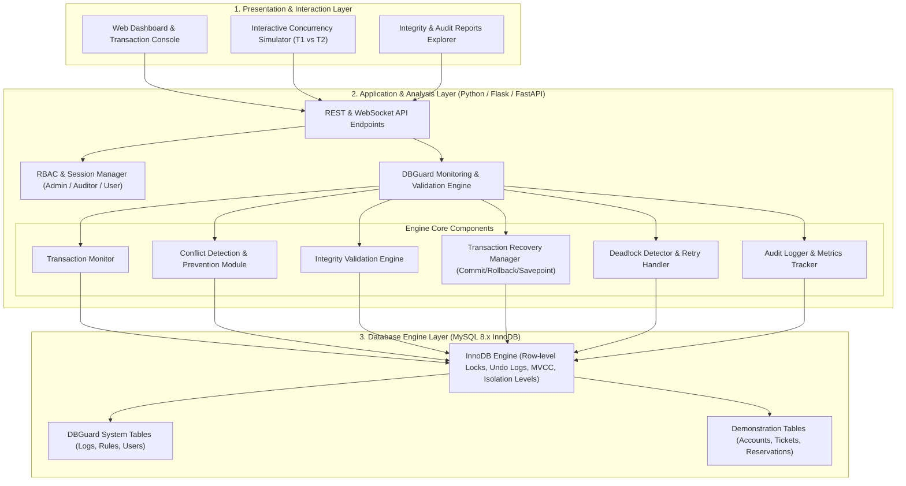

# DBGuard: Comprehensive Project Blueprint & Step-by-Step Implementation Analysis

> **Project Name:** DBGuard — Intelligent Database Integrity and Transaction Conflict Prevention System  
> **Domain:** Advanced DBMS / Database Engineering  
> **Primary Technologies:** MySQL 8.x (InnoDB Engine), Python (Flask/FastAPI), SQL / Concurrency Simulators, HTML5/CSS/JavaScript (Interactive Dashboard)  
> **Central Innovation:** Concurrent Transaction Conflict Prevention & Real-time Correctness Observation

---

## 1. Executive Summary & Project Purpose

Modern enterprise applications depend on relational databases to uphold the **ACID** (Atomicity, Consistency, Isolation, Durability) guarantees under high concurrency. In reality, poorly configured transaction boundaries, incorrect isolation levels, and missing concurrency controls lead to subtle data corruptions such as:
- **Lost Updates (Read-Modify-Write anomalies)**
- **Double-booking / Resource over-allocation race conditions**
- **Deadlocks causing unhandled transaction abortions**
- **Inconsistent reads across multiple queries (Non-repeatable reads / Phantom reads)**
- **Integrity constraint violations that disrupt workflows without recovery**

Unlike standard CRUD management systems that simply store and fetch data, **DBGuard** is an **observability, simulation, and prevention platform**. It instruments MySQL InnoDB's native transaction and locking mechanisms, reproduces real-world concurrency flaws in controlled dual/multi-session environments, demonstrates prevention techniques (pessimistic locking, optimistic locking, serializable transactions), and provides an interactive dashboard with audit trails.

---

## 2. System Architecture



### Architectural Principles
1. **Engine-Native Enforcement:** MySQL InnoDB handles native row-level locks, latching, write-ahead logging (redo log), and MVCC undo logs. DBGuard does not replace InnoDB; it instruments, controls, and analyzes transactions.
2. **Deterministic Multi-Session Simulation:** Using multi-threading in Python, DBGuard creates distinct database connections (`Connection T1`, `Connection T2`) to simulate concurrent clients interleaved with microsecond-controlled delays or explicit barrier synchronization.
3. **Dual Execution Modes (Unsafe vs Safe):** Every concurrency scenario is implemented in two modes:
   - **Unsafe Mode:** Demonstrates the vulnerability and records the resulting data anomaly.
   - **Safe Mode:** Applies proper locking (`SELECT ... FOR UPDATE`), transaction isolation (`SERIALIZABLE`), or optimistic concurrency checks (`version` column), recording zero data anomaly.

---

## 3. Database Schema Design

The schema is divided into **DBGuard Metadata/System Tables** and **Demonstration Domain Tables**.

### 3.1 DBGuard System Tables (Monitoring & Metadata)

```sql
-- 1. User management and Role-Based Access Control
CREATE TABLE dbguard_users (
    user_id INT AUTO_INCREMENT PRIMARY KEY,
    username VARCHAR(50) NOT NULL UNIQUE,
    password_hash VARCHAR(255) NOT NULL,
    full_name VARCHAR(100) NOT NULL,
    role ENUM('ADMIN', 'AUDITOR', 'OPERATOR') NOT NULL DEFAULT 'OPERATOR',
    created_at TIMESTAMP DEFAULT CURRENT_TIMESTAMP
) ENGINE=InnoDB;

-- 2. Monitored Resources Registry
CREATE TABLE monitored_resources (
    resource_id INT AUTO_INCREMENT PRIMARY KEY,
    resource_name VARCHAR(100) NOT NULL UNIQUE,
    resource_type ENUM('TABLE', 'ROW', 'STORED_PROCEDURE') NOT NULL,
    description TEXT,
    created_at TIMESTAMP DEFAULT CURRENT_TIMESTAMP
) ENGINE=InnoDB;

-- 3. Configurable Monitoring Rules
CREATE TABLE monitoring_rules (
    rule_id INT AUTO_INCREMENT PRIMARY KEY,
    rule_name VARCHAR(100) NOT NULL UNIQUE,
    rule_type ENUM('CONCURRENCY_CONFLICT', 'INTEGRITY_CHECK', 'ISOLATION_ANOMALY', 'DEADLOCK_RISK') NOT NULL,
    enabled BOOLEAN NOT NULL DEFAULT TRUE,
    parameters JSON,
    created_at TIMESTAMP DEFAULT CURRENT_TIMESTAMP
) ENGINE=InnoDB;

-- 4. Transaction Lifecycle Logs
CREATE TABLE transaction_logs (
    transaction_id VARCHAR(64) PRIMARY KEY,
    user_id INT,
    session_id VARCHAR(64) NOT NULL,
    scenario_name VARCHAR(100) NOT NULL,
    isolation_level VARCHAR(30) NOT NULL,
    start_time TIMESTAMP(6) NOT NULL DEFAULT CURRENT_TIMESTAMP(6),
    end_time TIMESTAMP(6) NULL,
    status ENUM('RUNNING', 'COMMITTED', 'ROLLED_BACK', 'DEADLOCK_ABORTED', 'FAILED') NOT NULL,
    affected_rows INT DEFAULT 0,
    details JSON,
    FOREIGN KEY (user_id) REFERENCES dbguard_users(user_id) ON DELETE SET NULL
) ENGINE=InnoDB;

-- 5. Detected Conflict Logs
CREATE TABLE conflict_logs (
    conflict_id INT AUTO_INCREMENT PRIMARY KEY,
    transaction_id VARCHAR(64),
    conflict_type ENUM('LOST_UPDATE', 'DOUBLE_BOOKING', 'DEADLOCK', 'DIRTY_READ', 'NON_REPEATABLE_READ', 'LOCK_TIMEOUT') NOT NULL,
    severity ENUM('LOW', 'MEDIUM', 'HIGH', 'CRITICAL') NOT NULL,
    detected_at TIMESTAMP(6) DEFAULT CURRENT_TIMESTAMP(6),
    resolution_status ENUM('DETECTED_CORRUPTED', 'PREVENTED_PESSIMISTIC', 'PREVENTED_OPTIMISTIC', 'RETRIED_SUCCESSFULLY', 'ROLLED_BACK') NOT NULL,
    details JSON,
    FOREIGN KEY (transaction_id) REFERENCES transaction_logs(transaction_id) ON DELETE CASCADE
) ENGINE=InnoDB;

-- 6. Integrity Constraint Violations
CREATE TABLE integrity_violations (
    violation_id INT AUTO_INCREMENT PRIMARY KEY,
    resource_id INT,
    constraint_type ENUM('PRIMARY_KEY', 'FOREIGN_KEY', 'UNIQUE', 'CHECK_CONSTRAINT', 'BUSINESS_RULE') NOT NULL,
    table_name VARCHAR(100) NOT NULL,
    details JSON,
    detected_at TIMESTAMP(6) DEFAULT CURRENT_TIMESTAMP(6),
    FOREIGN KEY (resource_id) REFERENCES monitored_resources(resource_id) ON DELETE SET NULL
) ENGINE=InnoDB;

-- 7. System Audit Logs
CREATE TABLE audit_logs (
    audit_id INT AUTO_INCREMENT PRIMARY KEY,
    user_id INT,
    action VARCHAR(100) NOT NULL,
    result ENUM('SUCCESS', 'FAILURE', 'WARNING') NOT NULL,
    ip_address VARCHAR(45),
    timestamp TIMESTAMP DEFAULT CURRENT_TIMESTAMP,
    payload_summary VARCHAR(500),
    FOREIGN KEY (user_id) REFERENCES dbguard_users(user_id) ON DELETE SET NULL
) ENGINE=InnoDB;
```

### 3.2 Demonstration Domain Tables

```sql
-- Bank Accounts Table (Lost Update & Negative Balance Testing)
CREATE TABLE demo_accounts (
    account_id INT AUTO_INCREMENT PRIMARY KEY,
    account_number VARCHAR(20) NOT NULL UNIQUE,
    holder_name VARCHAR(100) NOT NULL,
    balance DECIMAL(12, 2) NOT NULL DEFAULT 0.00,
    version INT NOT NULL DEFAULT 1,  -- Optimistic lock counter
    updated_at TIMESTAMP DEFAULT CURRENT_TIMESTAMP ON UPDATE CURRENT_TIMESTAMP,
    CONSTRAINT chk_positive_balance CHECK (balance >= 0.00)
) ENGINE=InnoDB;

-- Ticket Inventory (Double Booking & Deadlock Testing)
CREATE TABLE demo_tickets (
    ticket_id INT AUTO_INCREMENT PRIMARY KEY,
    event_name VARCHAR(100) NOT NULL,
    seat_code VARCHAR(10) NOT NULL UNIQUE,
    price DECIMAL(8, 2) NOT NULL,
    status ENUM('AVAILABLE', 'HELD', 'BOOKED') NOT NULL DEFAULT 'AVAILABLE',
    booked_by_user_id INT NULL,
    version INT NOT NULL DEFAULT 1,
    CONSTRAINT fk_booked_user FOREIGN KEY (booked_by_user_id) 
        REFERENCES dbguard_users(user_id) ON DELETE SET NULL
) ENGINE=InnoDB;

-- Reservations Table (Multi-step transaction & Savepoint testing)
CREATE TABLE demo_reservations (
    reservation_id INT AUTO_INCREMENT PRIMARY KEY,
    user_id INT NOT NULL,
    ticket_id INT NOT NULL,
    amount_paid DECIMAL(8, 2) NOT NULL,
    status ENUM('CONFIRMED', 'CANCELLED', 'PARTIAL_REFUND') NOT NULL DEFAULT 'CONFIRMED',
    created_at TIMESTAMP DEFAULT CURRENT_TIMESTAMP,
    FOREIGN KEY (user_id) REFERENCES dbguard_users(user_id),
    FOREIGN KEY (ticket_id) REFERENCES demo_tickets(ticket_id)
) ENGINE=InnoDB;
```

---

## 4. In-Depth Module Specifications

### Module 1: Transaction Monitoring
- **Functionality:** Tracks transaction boundaries (`START TRANSACTION`, `COMMIT`, `ROLLBACK`, `SAVEPOINT`).
- **Telemetry:** Captures transaction runtime duration, session connection ID (`CONNECTION_ID()`), current isolation level (`@@transaction_isolation`), and lock wait time (`performance_schema.data_locks` or `information_schema.innodb_trx`).
- **State Machine:**
  $$\text{INIT} \rightarrow \text{ACTIVE} \rightarrow \begin{cases} \text{COMMITTED} \\ \text{ROLLED\_BACK} \\ \text{DEADLOCK\_ABORTED} \end{cases}$$

### Module 2: Conflict Detection & Prevention (Central Innovation)
Demonstrates and prevents three primary concurrency conflict archetypes:

1. **Lost Update Anomaly:**
   - *Unsafe:* Two concurrent threads read `balance = 1000`. T1 subtracts 100 and writes 900. T2 subtracts 200 and writes 800. Final balance is 800 (100 loss).
   - *Safe Prevention A (Pessimistic):* `SELECT balance FROM demo_accounts WHERE account_id = 1 FOR UPDATE;` T2 blocks until T1 commits.
   - *Safe Prevention B (Optimistic):* `UPDATE demo_accounts SET balance = balance - 200, version = version + 1 WHERE account_id = 1 AND version = :v;` If rows affected = 0, conflict detected; retry or fail cleanly.
   - *Safe Prevention C (Atomic DDL):* `UPDATE demo_accounts SET balance = balance - 100 WHERE account_id = 1 AND balance >= 100;`

2. **Duplicate Reservation / Double-Booking:**
   - *Unsafe:* T1 and T2 both check `status = 'AVAILABLE'` for seat `A-101`. Both attempt to reserve it.
   - *Safe Prevention:* InnoDB row-level locking + UNIQUE composite constraint (`UNIQUE(event_name, seat_code)`).

3. **Deadlock Simulation & Controlled Recovery:**
   - *Scenario:* T1 locks Account A, then attempts to lock Account B. Concurrently, T2 locks Account B, then attempts to lock Account A.
   - *InnoDB Behavior:* Detects cycle in the wait-for graph, throws MySQL Error 1213: `Deadlock found when trying to get lock; try restarting transaction`.
   - *DBGuard Handler:* Catches Error 1213, writes to `conflict_logs`, executes a controlled exponential backoff retry up to 3 times, succeeding without human intervention.

### Module 3: Integrity Validation
- **Schema-Level Enforcement:** Primary key uniqueness, Foreign Key referential integrity (`ON DELETE CASCADE / SET NULL`), `CHECK` constraints (e.g. `balance >= 0.00`).
- **Application-Level Business Rules:** Validates domain invariants prior to execution and catches database integrity errors gracefully (translating MySQL error 1062, 1452, 3819 into human-readable alerts).

### Module 4: Transaction Recovery & Savepoints
- Demonstrates nested transaction states using `SAVEPOINT savepoint_name` and `ROLLBACK TO SAVEPOINT savepoint_name`.
- *Example Flow:* A user purchases 2 tickets in a single batch transaction. Ticket 1 succeeds. Ticket 2 fails (e.g. balance check fails). Rather than aborting the entire batch or leaving a corrupted state, the transaction rolls back to the intermediate savepoint and commits Ticket 1.

### Module 5: Role-Based Audit Logging
- Enforces strict audit trails with three distinct user roles:
  - **ADMIN:** Configure monitoring rules, trigger simulations, reset database state.
  - **OPERATOR:** Execute transactions, view real-time transaction consoles.
  - **AUDITOR:** Read-only access to audit logs, conflict history, and compliance reports.
- Logs include timestamps with microsecond precision, affected resource IDs, sanitizing any sensitive parameters.

### Module 6: Dashboard & Analytics
- **Live Simulator Console:** Visual side-by-side transaction timeline showing Thread 1 and Thread 2 steps, lock acquisition, wait states, and commits.
- **Analytics Cards:** Conflict rate percentage, average lock wait time, total deadlocks handled, integrity violations blocked.
- **Before-and-After Comparison View:** Shows Unsafe Result vs Safe Controlled Result side-by-side with balance calculations.

---

## 5. Step-by-Step Implementation Roadmap

| Phase | Milestone | Tasks & Deliverables | Estimated Effort |
|:---|:---|:---|:---|
| **Phase 1** | **Core DBMS Setup & Schemas** | - Install MySQL 8.x and verify InnoDB engine.<br>- Run DDL script for `dbguard_` system tables and `demo_` tables.<br>- Seed sample initial records (bank accounts, event seats, users).<br>- Test basic transaction scripts (`COMMIT`, `ROLLBACK`, `SAVEPOINT`). | Days 1–2 |
| **Phase 2** | **Python Engine & Simulation Core** | - Create Python virtual environment (`mysql-connector-python` or `PyMySQL`).<br>- Build `TransactionManager` class managing independent DB sessions.<br>- Implement **Lost Update** simulation (unsafe vs pessimistic vs optimistic).<br>- Implement **Deadlock** simulation (cross-locking accounts) with automatic retry handler.<br>- Implement **Integrity Validation** interceptors (catching errors 1062, 1452, 3819). | Days 3–5 |
| **Phase 3** | **Backend API & Audit Engine** | - Develop REST API using Flask or FastAPI.<br>- Endpoints: `/api/scenarios/run-lost-update`, `/api/scenarios/run-deadlock`, `/api/audit-logs`, `/api/conflicts`, `/api/system-state`.<br>- Implement RBAC middleware with JWT or session authentication.<br>- Wire audit logging into all scenario executions. | Days 6–8 |
| **Phase 4** | **Interactive Web Dashboard** | - Build responsive UI using Tailwind CSS & vanilla JS (or React).<br>- Create Interactive Simulation Console (T1 vs T2 split view with step-by-step playback).<br>- Build Comparison Visualizer (Unsafe outcome vs Safe outcome).<br>- Build Metrics & Audit Table Explorer with filtering and export. | Days 9–11 |
| **Phase 5** | **Testing, Verification & Presentation Deck** | - Run end-to-end automated test suite verifying all conflict types.<br>- Benchmark latency and lock wait metrics.<br>- Prepare demonstration script matching Page 5 of documentation.<br>- Package project with `README.md`, setup script, and demo video / slides. | Days 12–14 |

---

## 6. Detailed Presentation Demonstration Script

To present DBGuard successfully (e.g. for academic evaluation or technical demo), follow this exact 8-step script:

1. **Dashboard Initialization:** Open DBGuard web interface. Show initial database state: Account #1 has balance **\$1,000.00**.
2. **Unsafe Lost Update Run:**
   - Launch concurrent test: T1 deducts \$100, T2 deducts \$200 without locks.
   - Show how both read \$1,000. T1 writes \$900, T2 writes \$800.
   - Alert appears: `CONFLICT DETECTED: Lost Update Anomaly! Expected balance: $700.00, Actual: $800.00. Data Loss: $100.00.`
3. **Safe Controlled Execution:**
   - Toggle switch to "Pessimistic Locking (`SELECT ... FOR UPDATE`)".
   - Re-run test with reset balance \$1,000.
   - Show T2 entering `LOCK_WAIT` while T1 holds row lock. T1 commits \$900, T2 acquires lock, reads \$900, deducts \$200, commits \$700.
   - Alert: `SUCCESS: Transaction serialized safely. Final balance: $700.00.`
4. **Deadlock Demonstration & Auto-Retry:**
   - Run T1 (locks Account A $\rightarrow$ requests Account B) and T2 (locks Account B $\rightarrow$ requests Account A).
   - MySQL throws Error 1213. DBGuard captures deadlock, logs it, initiates automatic retry with backoff, and commits both successfully.
5. **Integrity Rule Validation:**
   - Attempt an illegal transaction: Deduct \$1,500 from Account #1 (balance \$700).
   - MySQL `CHECK (balance >= 0)` constraint triggers Error 3819.
   - DBGuard catches and records violation in `integrity_violations` table with zero partial state saved.
6. **Savepoint Partial Rollback:**
   - Run multi-step transaction: Book Seat 1 (Valid) + Book Seat 2 (Invalid duplicate).
   - Show `ROLLBACK TO SAVEPOINT` keeping Seat 1 without discarding the entire operation.
7. **Audit & Compliance Review:**
   - Switch to Auditor view. Review time-stamped audit entries, query details, and conflict logs.
8. **Conclusion & Q&A:**
   - Summarize how DBGuard transforms opaque DBMS internal locking and transaction mechanics into an observable, robust engineering control plane.
