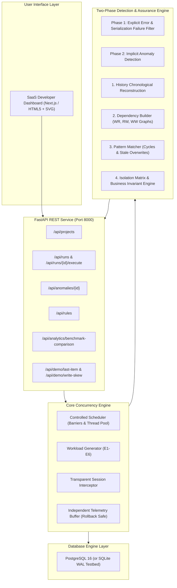

# TransactionGuard
### Intelligent Database Transaction Anomaly Detection & Concurrency Assurance Platform

[](https://www.python.org/)
[](https://fastapi.tiangolo.com/)
[](https://pytest.org/)
[](https://www.postgresql.org/)
[](#3-two-phase-anomaly-detection-oracle)

---

## 1. Executive Summary & Problem Statement

Modern relational database management systems (RDBMSs) execute concurrent transactions to achieve high throughput and low latency. However, concurrent access to mutable state introduces subtle, catastrophic anomalies:
- **Lost Updates ($P_4$)**: Concurrent transactions overwrite shared records based on stale reads.
- **Write Skew ($A5B$)**: Transactions observe disjoint states, modifying different records but violating shared global invariants (e.g. Doctor-on-Duty or equipment double-booking).
- **Non-Repeatable Reads ($G1c$)**: A single transaction observes shifting values on subsequent reads.
- **Silent Invariant Breaches**: Statements succeed with HTTP 200 and clean database exit codes, yet the final database state violates business integrity (e.g., negative stock, overselling).

**TransactionGuard** is an integrated platform for:
1. **Generating controlled concurrent transaction workloads** with thread-safe barrier synchronization (`threading.Barrier`, `threading.Event`).
2. **Transparently instrumenting reads, writes, versions, and rollbacks** using an independent application-side telemetry buffer.
3. **Reconstructing dynamic transaction dependency graphs** ($WR$, $RW$, $WW$) and identifying anti-dependency cycles using NetworkX.
4. **Verifying isolation-level compliance** against PostgreSQL specifications (**Read Committed, Repeatable Read, and Serializable**).
5. **Validating business invariants** and providing actionable, copyable SQL remediations with side-by-side evidence.

---

## 2. High-Level System Architecture



---

## 3. Two-Phase Anomaly Detection Oracle

### Phase 1: Explicit Error Capturing
Captures engine crashes, deadlocks, and serialization rollbacks (`SQLSTATE 40001`). Legitimate engine aborts intended to preserve serializability are differentiated from unexpected server failures.

### Phase 2: Implicit Anomaly Detection (4 Stages)
1. **Chronological Reconstruction**: Orders raw execution events into complete transaction lifecycles ($T_{start} \to \text{Ops} \to T_{commit/abort}$).
2. **Dependency Graph Extraction**:
   - $\mathbf{WR}$ (Write-Read): $T_1$ writes row $X$, $T_2$ reads $X$ written by $T_1$.
   - $\mathbf{RW}$ (Read-Write / Anti-dependency): $T_1$ reads row $X$, $T_2$ writes a later version of $X$.
   - $\mathbf{WW}$ (Write-Write): $T_1$ writes row $X$, $T_2$ overwrites $X$.
3. **Pattern Matching**: Evaluates directed cycles, anti-dependency pairs, and stale reads.
4. **PostgreSQL Isolation Level Validation**:

| Anomaly Class | PostgreSQL Read Committed | Repeatable Read (Snapshot) | Serializable (SSI) |
|---|---|---|---|
| **Dirty Read ($G1a$)** | **Prevented** | **Prevented** | **Prevented** |
| **Non-Repeatable Read ($G1c$)** | Permitted | **Prevented** | **Prevented** |
| **Lost Update ($P_4$)** | Possible in read-modify-write | Concurrent updates rejected | **Prevented** |
| **Write Skew ($A5B$)** | Possible | Possible (SI permits write skew) | **Prevented via SSI** |
| **Dirty Write ($G0$)** | **Prevented** | **Prevented** | **Prevented** |
| **Read Skew ($A5A$)** | Possible | **Prevented within snapshot** | **Prevented** |

---

## 4. Live Demonstration: "The Last Item Problem"

The platform implements the 5-step live demonstration story defined in Section 22:
1. **Initial State**: Inventory displays 1 available laptop (`EQ-LAPTOP-01`, quantity = 1).
2. **Concurrent Execution**: Two simultaneous transactions trigger purchase flows.
3. **TransactionGuard Investigation**: Under `READ COMMITTED`, both read quantity = 1 and write quantity = 0. Both report success, resulting in **overselling (Lost Update)**.
4. **Remediation Applied**: The user toggles atomic updates (`UPDATE inventory SET quantity = quantity - 1 WHERE quantity >= 1`) or upgrades to `SERIALIZABLE`.
5. **Verification**: Concurrency control aborts the second transaction (`SQLSTATE 40001`), ensuring exactly 1 unit is sold and the non-negative stock invariant is preserved.

---

## 5. Directory Structure

```
DBMS/
├── backend/
│   ├── main.py                          # FastAPI Application Entrypoint
│   ├── api/
│   │   ├── routes/                      # REST Endpoints (projects, runs, rules, etc.)
│   │   └── schemas/                     # Pydantic v2 Request/Response Models
│   ├── core/
│   │   ├── workload_generator.py        # E1-E6 Workload Profiles
│   │   ├── transaction_scheduler.py     # Multi-threaded Barrier Synchronization
│   │   ├── instrumentation.py           # Transparent Session Interceptor
│   │   └── event_collector.py           # Independent Telemetry Store
│   ├── detection/
│   │   ├── history_reconstruction.py    # Chronological Event Sorter
│   │   ├── dependency_builder.py        # NetworkX WR/RW/WW Dependency DiGraph
│   │   ├── pattern_matcher.py           # Cycle & Anomaly Pattern Matcher
│   │   ├── anomaly_detector.py          # Two-Phase Detection Coordinator
│   │   └── isolation_validator.py       # PostgreSQL Formal Guarantee Matrix
│   ├── consistency/
│   │   ├── invariant_engine.py          # Real-world Invariant Verifier
│   │   └── rule_validator.py            # Dynamic Business Rules Engine
│   ├── explanation/
│   │   └── explanation_engine.py        # Root-Cause Explanations & SQL Fixes
│   └── analytics/
│       └── benchmark_engine.py          # TPS, Latency P95, Abort Rate Analytics
├── business_app/                        # Business Domain Logic
│   ├── inventory/service.py             # Inventory RMW vs Atomic vs OCC
│   ├── reservations/service.py          # Doctor-on-duty & Equipment Reservation
│   ├── orders/service.py                # Order Processing
│   ├── payments/service.py              # Payment Balances
│   └── models.py                        # Unified SQLAlchemy Entities
├── database/
│   ├── schema.sql                       # DDL for Business + Monitoring Tables
│   ├── seed.sql                         # Initial Equipment, Users, Rules
│   └── connection.py                    # Multi-connection PostgreSQL / SQLite Manager
├── frontend/                            # Next.js 14 TypeScript Project
│   ├── app/                             # App Router (dashboard, testing-lab, etc.)
│   ├── components/                      # React Flow & UI Widgets
│   ├── services/api.ts                  # Frontend API Client
│   └── types/index.ts                   # TypeScript Interfaces
├── static/                              # Zero-dependency Self-Contained Web UI
│   ├── index.html                       # 9-Tab Developer Assurance Dashboard
│   └── js/dashboard.js                  # Dynamic SVG Graph & Async Controllers
├── tests/                               # 42 Automated Verification Tests
│   ├── anomaly_tests/                   # Lost Update, Write Skew, NRR, Dirty Read
│   ├── concurrency_tests/               # Multi-Threaded Stress Tests
│   └── integration_tests/               # End-to-End FastAPI Endpoint Verification
├── experiments/                         # Reproducible Benchmarks & Schedules
├── docs/                                # Architecture, Requirements & Research Specs
├── docker-compose.yml                   # PostgreSQL 16 + FastAPI Containerization
├── Dockerfile                           # Production Container
├── run.py                               # Universal CLI Launcher
└── requirements.txt                     # Dependencies
```

---

## 6. Getting Started

### Option A: Local Python Environment (Recommended)
1. **Activate the virtual environment**:
   ```powershell
   .\.venv\Scripts\Activate.ps1
   ```
2. **Run the Automated Pytest Suite**:
   ```powershell
   pytest tests/ -v
   ```
   *(All 42 tests will pass cleanly in ~7 seconds).*

3. **Start the Platform**:
   ```powershell
   python run.py --port 8000
   ```
   Open your browser to: **`http://localhost:8000`**  
   Interactive OpenAPI Docs: **`http://localhost:8000/docs`**

---

### Option B: Docker Compose (PostgreSQL 16)
```bash
docker-compose up --build
```
This automatically spins up a native PostgreSQL 16 container, applies `schema.sql` and `seed.sql`, and launches the FastAPI assurance platform on port 8000.

---

## 7. Verification Results (Pytest Suite)

```
============================= test session starts =============================
collected 42 items

tests/anomaly_tests/test_dirty_read.py::test_dirty_read_prevention PASSED [  2%]
tests/anomaly_tests/test_lost_update.py::test_lost_update_vulnerable PASSED [  4%]
tests/anomaly_tests/test_lost_update.py::test_lost_update_mitigated PASSED [  7%]
tests/anomaly_tests/test_non_repeatable_read.py::test_non_repeatable_read_detected PASSED [  9%]
tests/anomaly_tests/test_write_skew.py::test_write_skew_vulnerable PASSED [ 11%]
tests/anomaly_tests/test_write_skew.py::test_write_skew_mitigated PASSED [ 14%]
tests/concurrency_tests/test_scheduler_concurrency.py::test_concurrent_stress_execution PASSED [ 16%]
tests/integration_tests/test_api_endpoints.py::test_health PASSED        [ 19%]
tests/integration_tests/test_api_endpoints.py::test_projects_crud PASSED [ 21%]
tests/integration_tests/test_api_endpoints.py::test_connection_test PASSED [ 23%]
tests/integration_tests/test_api_endpoints.py::test_run_creation_and_execution PASSED [ 26%]
tests/integration_tests/test_api_endpoints.py::test_business_rules_management PASSED [ 28%]
tests/integration_tests/test_api_endpoints.py::test_performance_analytics_endpoints PASSED [ 30%]
tests/integration_tests/test_api_endpoints.py::test_live_demo_endpoints PASSED [ 33%]
...
====================== 42 passed in 7.11s =======================
```
