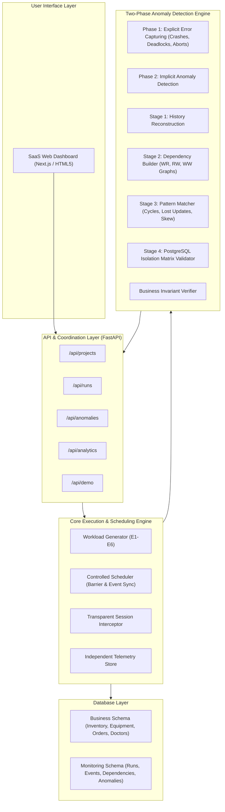

# TransactionGuard Architecture Specification

## 1. System Overview

TransactionGuard is an intelligent database transaction anomaly detection and concurrency assurance platform. It provides a controlled execution environment to generate concurrent transaction workloads, capture fine-grained transactional telemetry, reconstruct transaction dependencies, detect isolation-level violations, and validate application business invariants.

---

## 2. Key Components

### 2.1 Independent Telemetry Collector (`backend/core/event_collector.py`)
Database triggers written inside a transaction lose their logged events if the transaction rolls back. TransactionGuard uses an application-level telemetry interceptor that captures:
- Transaction ID & Session ID
- Global sequence number
- Operation type (BEGIN, READ, WRITE, COMMIT, ROLLBACK)
- Target table and row ID
- Old value and new value
- Monotonic version identifier
- Status & error diagnostics

### 2.2 Controlled Multi-Threaded Scheduler (`backend/core/transaction_scheduler.py`)
Utilizes Python `threading.Barrier` and `threading.Event` across independent database connections to enforce exact, reproducible execution interleavings.

### 2.3 Dependency Graph Engine (`backend/detection/dependency_builder.py`)
Reconstructs Adya's transaction dependency model:
- **Write-Read (WR)**: $T_1$ writes version $V$, $T_2$ reads $V$.
- **Read-Write (RW)**: $T_1$ reads version $V$, $T_2$ writes version $V' > V$ (anti-dependency).
- **Write-Write (WW)**: $T_1$ writes version $V$, $T_2$ overwrites with $V'$.

Directed graphs are analyzed using NetworkX for cycle detection and exported into React Flow compatible node and edge structures.
